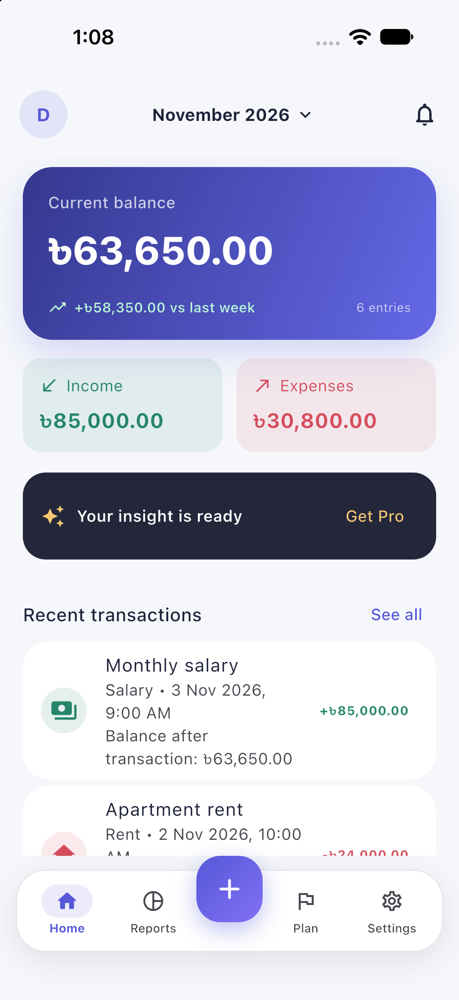
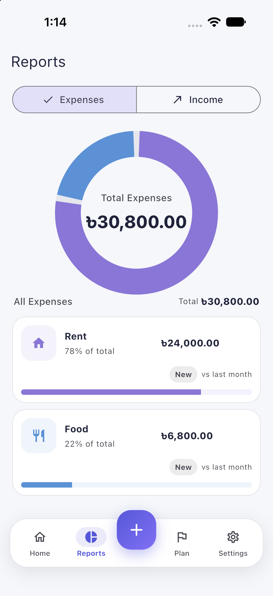
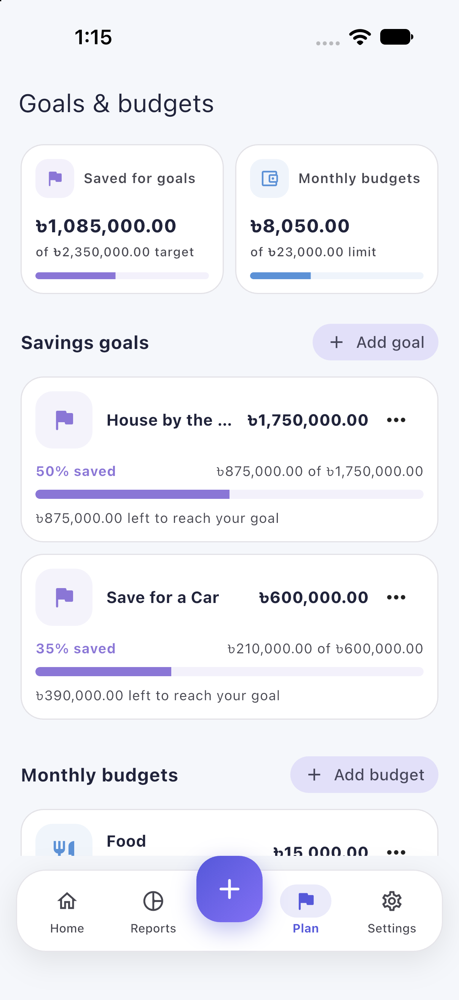
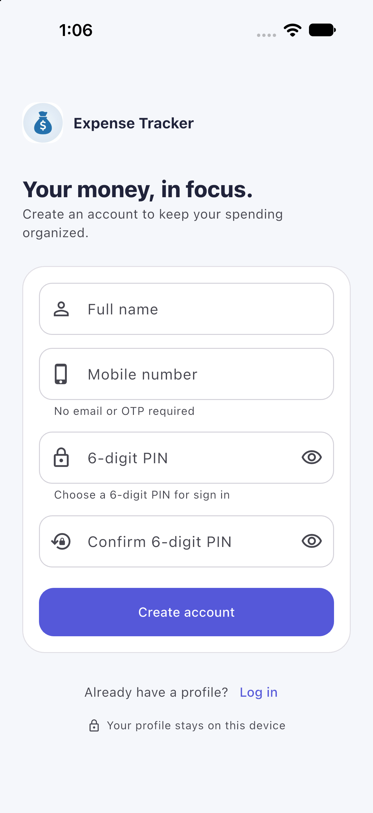

<div align="center">
  
  <h1>Expense Tracker</h1>
  <p>A clean, offline-first Flutter app for tracking spending, income, savings goals, and budgets.</p>
  <p>
    <a href="https://github.com/ajharulislamdev/Expens_tracker/releases/latest">Download for Android</a>
    ·
    <a href="https://github.com/ajharulislamdev/Expens_tracker/issues">Report an issue</a>
  </p>
</div>

## Screenshots

These previews use fictional sample data.

<div align="center">
  
  
  
  
</div>

## Features

- **Dashboard:** View your balance, income, expenses, and recent transactions by day, week, or month.
- **Transactions:** Add, edit, delete, search, filter, and sort income and expense entries.
- **Reports:** Explore category breakdowns and compare periods; export reports as PDF or Excel.
- **Goals and budgets:** Create and manage savings goals and monthly spending limits.
- **Flexible currency:** Choose a supported currency or add a custom symbol.
- **Local sign-in:** Create a profile using a mobile number and six-digit PIN. Existing password-based profiles remain supported.
- **PIN recovery:** Verify the current PIN or legacy password before setting a new PIN.
- **Daily reminder:** Schedule a local reminder to record expenses.
- **Local profile settings:** Edit profile details, choose a photo, change your PIN, or sign out.

## Download

Download the latest Android APK from [GitHub Releases](https://github.com/ajharulislamdev/Expens_tracker/releases/latest).

The current Android release build uses the debug signing configuration in [`android/app/build.gradle.kts`](android/app/build.gradle.kts). It is suitable for evaluation and sideloading, but configure a private release keystore before distributing production updates.

## Run from source

### Requirements

- Flutter 3.24 or newer
- Dart 3.5 or newer
- Android Studio/Xcode for the platform you want to run

```bash
git clone https://github.com/ajharulislamdev/Expens_tracker.git
cd Expens_tracker
flutter pub get
flutter run
```

To create an Android APK:

```bash
flutter build apk --release
```

## Tech stack

- Flutter and Dart
- GetX for state management and navigation
- Hive for on-device storage
- Custom-painted charts for report visualizations
- PDF and Excel export
- Local notifications

## Architecture

```text
View → GetX controller → Repository → HiveProvider → Hive
```

- `lib/app` — bindings, routes, and themes
- `lib/core` — constants, utilities, and services
- `lib/data` — models, repositories, and Hive provider
- `lib/modules` — authentication, dashboard, plans, reports, and transactions

Hive adapters are maintained in source; code generation is not required.

## Privacy and storage

The app stores profiles, transactions, goals, budgets, and settings locally on the device. It does not require an email address or send this data to a backend. Sign-in credentials are salted and hashed, but local sign-in does not encrypt transaction or plan data. Keep a separate backup of important information.

PDF and Excel exports are saved to `Download/ExpenseTracker` when the platform allows it, with an app-specific storage fallback.
